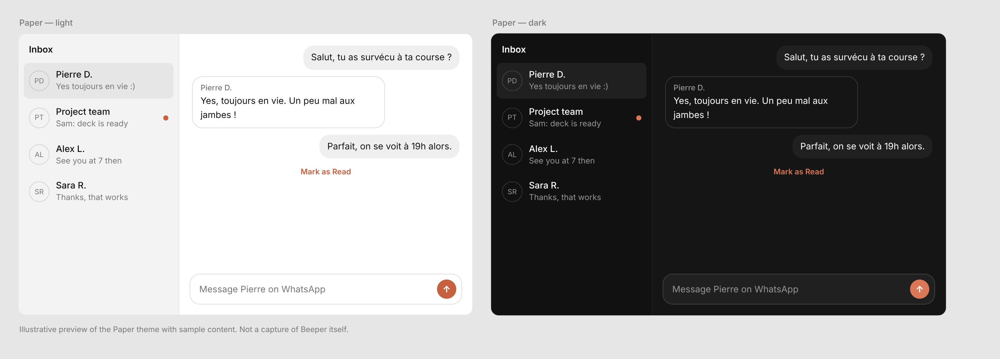

# Paper: a minimalist theme for Beeper Desktop

A neutral, Claude-inspired custom CSS theme for Beeper Desktop. Neutral grey surfaces, outlined received messages, soft grey sent messages, and one terracotta accent for buttons, links and toggles. The palette uses the colour values claude.ai itself uses (neutral greys and the #d97757 accent). It follows your system's light or dark setting.

The image is an illustration with sample content, not a capture of Beeper.

## Install

1. Open Beeper Desktop, then Settings → Appearance, and scroll to Custom CSS.
2. Click "Open CSS file in editor", replace its contents with `paper.css`, and save.
3. Click "Reload CSS" (not "Reset CSS").

"Reset CSS" in the same menu returns Beeper to its default look.

## Known limits

- Tested on one Windows install of Beeper Desktop. Class names such as `MessageContent-module__contents` come from that build and may differ in others.
- Sender names, the composer card and the account dot use selectors taken from Beeper's Texts theme and are not confirmed on every build.
- Network badges (WhatsApp, LinkedIn, Signal) are not themed.
- Light or dark follows the system setting, not Beeper's own appearance setting.
- Community themes get no official Beeper support. See the [beeper/themes](https://github.com/beeper/themes) README for where to get help.
